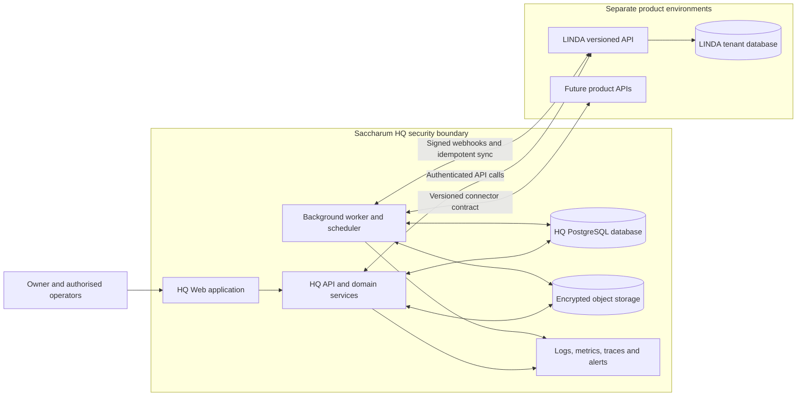

# Saccharum HQ — Architecture and Delivery Blueprint

**Status:** Architecture proposal; not production implementation  
**Owner:** Saccharum Technologies  
**Product portfolio:** LINDA and future Saccharum products  
**Principle:** One operating view of the company, with explicit boundaries between portfolio operations and each customer's private business data.

## 1. Purpose and product boundary

Saccharum HQ is the internal command centre for Saccharum Technologies. It is not the same thing as a customer's LINDA Main Admin area.

- **LINDA tenant administration** manages one subscribing business: its people, branches, records, settings and subscription experience.
- **Saccharum HQ** manages Saccharum as the platform owner: the product portfolio, customer accounts, platform health, revenue, cash movement, tax/compliance obligations, support, feedback, incidents, releases and operating tasks.
- **Future products** should connect through a controlled integration contract rather than each inventing its own owner dashboard.

HQ must not become a shortcut around tenant security. It should default to aggregate business metrics and operational metadata. Access to tenant content must be exceptional, purpose-bound, time-limited, approved and audited.

## 2. Operating domains

### 2.1 Executive overview
- Monthly recurring revenue (MRR), annual recurring revenue (ARR), new and churned subscriptions, trial conversion, active customers and product adoption.
- Cash position and runway are shown separately from invoiced revenue and accounting profit.
- Period comparisons, trend lines, target tracking and data freshness indicators.
- Every metric links to its definition, source, period and last refresh time.

### 2.2 Customer and subscription operations
- Customer/business directory across products; product, plan, status, start date, renewal date and account owner.
- Trial lifecycle, onboarding completion, activation milestones, plan changes, failed payments, cancellations and churn reasons.
- Usage snapshots and limit warnings.
- Customer health signals and support history.
- No final LINDA price list is approved by this document. Existing repository seed prices are implementation defaults only. Commercial prices must be selected through a separate pricing decision and approved before customer-facing publication.

### 2.3 Money and finance operations
- Revenue ledger: invoices/statements, receipts, refunds, credits, discounts and adjustments.
- Payment reconciliation: expected amount, provider transaction, settlement, fees, net settlement, mismatch and resolution.
- Expenses and supplier commitments, recurring costs, hosting, software, contractors and operating spend.
- Cash flow forecast and runway.
- Separate views for invoiced revenue, cash received, outstanding debtors, refunds, expenses and accounting profit.
- Immutable source transactions with correction entries rather than silent edits.
- Exportable period packs for bookkeeping and accountant review.

HQ must not present an amount as cash received merely because an invoice or subscription statement exists.

### 2.4 Tax and statutory obligations
- VAT output and input tracking, tax-period calendar, filing/payment deadlines, evidence attachments, review state and accountable owner.
- Provisional/company tax and other obligations only when the entity's registration and tax profile make them applicable.
- Reconcile tax calculations to the finance ledger and accountant-approved records.
- Support draft, reviewed, filed, paid and overdue states with supporting evidence.
- Tax rules and rates are configuration with effective dates and a source/reviewer, not hard-coded dashboard assumptions.
- HQ is an operations and evidence system, not a substitute for professional tax advice or SARS filing systems.

### 2.5 Support, messages and feedback
- Unified inbox for customer messages, product feedback, bug reports, feature requests and complaints.
- Link each item to customer, product, subscription, severity, owner, status, SLA and resolution.
- Internal notes separated from customer-visible replies.
- Feedback themes, repeated pain points, sentiment tags and product-request voting.
- Delivery status for email and other connected channels; failed messages are visible and retryable.

### 2.6 Platform performance and reliability
- API availability, latency percentiles, error rates, frontend errors, database health, queue depth and scheduler heartbeat.
- Backup age, last successful backup, off-site copy age and last successful restore drill.
- Deployment version, release time, migration state and rollback reference.
- Incident timeline, impact, mitigation, root cause, follow-up actions and post-incident review.
- Alerts are actionable, deduplicated and routed to an owner; a dashboard alone is not monitoring.

### 2.7 Product and engineering portfolio
- Product registry: LINDA, Khezwo, Loka and future products.
- Environments, repositories, deployment versions, dependencies, service ownership and release status.
- Roadmap, work items, blockers, risks, decisions and delivery milestones.
- Product usage and adoption indicators.
- Security findings, dependency updates, vulnerability triage and remediation evidence.

### 2.8 Company operations and governance
- Company tasks, recurring obligations, supplier contracts, insurance, domain/hosting renewals, licences and key dates.
- Document register with owner, version, expiry date, access classification and retention rule.
- Decision register: decision, rationale, alternatives, approver, date and review date.
- Role assignments and segregation of duties for finance, tax, support and platform administration.

## 3. Navigation and information architecture

Proposed top-level navigation:

1. **Overview** — company health, urgent alerts and key trends.
2. **Customers** — accounts, onboarding, health and support history.
3. **Subscriptions** — plans, trials, renewals, payment status and churn.
4. **Finance** — invoices, receipts, reconciliation, expenses, cash flow and reports.
5. **Tax & Compliance** — obligations, periods, evidence, reviews and deadlines.
6. **Inbox** — messages, feedback, incidents and requests.
7. **Platform Health** — services, performance, jobs, backups and deployments.
8. **Products & Engineering** — product portfolio, roadmap, releases and risks.
9. **Operations** — tasks, suppliers, contracts, assets and renewals.
10. **Reports** — scheduled and on-demand management packs.
11. **Settings & Audit** — users, roles, integrations, policies and audit trail.

The Overview should answer: What needs attention today? What changed? What is the financial position? Are customers receiving a healthy service? What obligations are approaching?

## 4. Reference architecture

Start as a **modular monolith** for HQ rather than premature microservices. Keep clear module boundaries and allow extraction only when scale or operational isolation justifies it.

### 4.1 Logical components

**Boundary rule:** HQ connects to LINDA through its API and signed events. There is deliberately no direct HQ-to-LINDA-database connection.

- **HQ web application:** authenticated operator interface, dashboards, workflows and reports.
- **HQ API:** authorization, validation, domain services and integration endpoints.
- **HQ relational database:** canonical HQ records, audit events, finance subledger and workflow state.
- **Integration adapters:** LINDA, payment provider, accounting export, email, monitoring and future product connectors.
- **Background worker:** scheduled imports, reconciliation, reminders, report generation and retryable jobs.
- **Observability pipeline:** structured logs, metrics, traces and alert routing.
- **Encrypted object storage:** statements, receipts, contracts, tax evidence, exports and backup artifacts.

### 4.2 Technology alignment

LINDA already uses FastAPI, SQLAlchemy, Alembic and PostgreSQL with a Next.js/React frontend. HQ can reuse proven engineering patterns and selected shared libraries, but it should have its own database, secrets, deployment boundary and access controls.

Do not couple HQ directly to LINDA's internal tables. Integrate through:
- versioned, authenticated APIs;
- signed webhooks with replay protection;
- scheduled, idempotent data synchronization where webhooks are unavailable;
- explicit event contracts and stable external identifiers.

### 4.3 Integration contract

Every product connector should expose a consistent set of concepts:
- product and environment identity;
- customer/account identity;
- subscription and plan state;
- usage snapshots;
- service health and release metadata;
- support/feedback references;
- event timestamp, schema version and source ID.

Events must be idempotent. Store source event IDs and processing outcomes. Retry transient failures with backoff; quarantine invalid events for review. Never allow a connector to write arbitrary HQ finance or tax records.

## 5. Core data model

Initial HQ entities:

| Domain | Core records |
| --- | --- |
| Identity | HQUser, Role, Permission, Session, MFAFactor |
| Portfolio | Product, Environment, Service, Repository, Release |
| Customer | CustomerAccount, ProductAccount, Contact, Onboarding |
| Subscription | Plan, Subscription, Trial, UsageSnapshot, SubscriptionEvent |
| Finance | Invoice, InvoiceLine, Receipt, Payment, Refund, Expense, Supplier, Reconciliation |
| Tax | TaxProfile, TaxPeriod, TaxObligation, TaxCalculation, FilingEvidence |
| Support | Conversation, Message, Feedback, Ticket, SLA, Attachment |
| Reliability | MetricSample, HealthCheck, Alert, Incident, BackupRecord, RestoreDrill |
| Operations | Task, Recurrence, Contract, Asset, Renewal, Document |
| Governance | Decision, Approval, AuditEvent, PolicyAcknowledgement |
| Integration | Connector, WebhookEvent, SyncRun, ExternalReference, DeadLetter |

Every business record should have an immutable ID, created/updated timestamps, actor/source, status and audit history where applicable. Money is stored in integer minor units with an explicit currency. Store tax rates and pricing versions with effective dates.

## 6. Security and access model

- Separate HQ identity provider/session/token namespace from LINDA business-user authentication.
- Mandatory MFA for privileged HQ roles before finance, tax or tenant-support workflows go live.
- Least-privilege roles: Owner, Platform Operations, Support, Finance, Tax Reviewer, Engineering/Read-only and Auditor.
- Sensitive actions require step-up authentication and, where appropriate, a second approver.
- Encrypt data in transit and at rest; manage secrets outside source control.
- Log sign-in attempts, exports, permission changes, financial edits, approvals, integration events and privileged customer-data access.
- Never log passwords, access tokens, reset tokens, payment secrets or full sensitive customer records.
- Use scoped support access: customer, reason, ticket, approved operator, expiry and full audit.
- Enforce retention, deletion and backup policies for personal information.
- Separate production and non-production data; never copy production personal data into test environments without an approved anonymisation process.

## 7. Financial and tax controls

- Define a chart of accounts and accounting policy with an accountant before treating HQ reports as statutory accounts.
- Maintain a double-entry ledger or integrate with a proper accounting system as the authoritative accounting record. Do not use dashboard totals as a ledger.
- Record gross amount, VAT, net amount, currency, transaction date, settlement date and source reference separately.
- Reconcile payment-provider settlements to receipts and bank statements.
- Require approval thresholds for refunds, write-offs, supplier payments and manual adjustments.
- Close periods with a review checklist; lock approved periods and correct them through adjustment entries.
- Tax calculations must retain the rule/rate version and evidence used.

## 8. Reliability, backups and disaster recovery

- Production database and object storage require independent encrypted off-site backups.
- Record backup start/end, artifact checksum, size, destination, retention expiry and verification result.
- Alert when the latest successful off-site copy exceeds the agreed recovery-point objective.
- Perform scheduled restore drills into an isolated environment; record measured recovery time and verification checks.
- Define RPO and RTO per service before launch. Initial targets are decisions to be approved, not assumptions.
- Use health checks, structured logs, metrics, tracing and actionable alerting.
- Deploy with reviewed migrations, health gates, rollback instructions and release audit records.

## 9. Delivery roadmap

### Phase 0 — Foundations and decisions
- Confirm Saccharum legal/entity profile, finance process and accounting system of record.
- Approve customer identity model, role matrix, data classification and retention.
- Choose hosting, encrypted object storage, backup destination and monitoring.
- Agree metric definitions, RPO/RTO, incident severity and approval thresholds.
- Finalise LINDA commercial pricing separately; do not promote current seed values as approved prices.

### Phase 1 — HQ shell and read-only portfolio visibility
- Separate HQ application, database and authentication.
- Product registry and LINDA connector.
- Customer/subscription read model, usage snapshots and onboarding state.
- Overview dashboard with source timestamps and data-quality warnings.
- Audit log and role-based access.

### Phase 2 — Support and platform operations
- Unified inbox, feedback, ticket workflow and customer-visible replies.
- Health checks, scheduler/job status, deployments, incidents and alerts.
- Backup inventory, off-site copy status and restore-drill records.
- Operational task register and renewal calendar.

### Phase 3 — Finance and tax controls
- Invoice/receipt import or subscription billing integration.
- Payment reconciliation and refund workflow.
- Expenses, supplier commitments and cash-flow reporting.
- Tax-period obligations, VAT evidence and accountant review workflow.
- Period close and export packs.

### Phase 4 — Product portfolio and automation
- Connect additional Saccharum products using the same integration contract.
- Portfolio roadmap, release coordination and cross-product adoption.
- Rules-based alerts, summaries and suggested actions.
- AI assistant only after permissions, source citations, audit and human approval controls are established.

## 10. Decisions that must remain explicit

The following must not be silently assumed by implementation:
- Final LINDA prices, plan entitlements and trial/grace-period policy.
- Payment gateway, billing frequency, proration, refunds and failed-payment policy.
- Saccharum legal/tax registrations and applicable filing obligations.
- Accounting system of record and chart of accounts.
- MFA provider and privileged access approval process.
- Backup destination, retention, RPO and RTO.
- Support SLAs and customer-data access policy.
- Whether HQ is a separate repository/application or shares selected components with LINDA. The default recommendation is a separate application and database with API-based integration.

## 11. Definition of done

HQ is ready for operational use only when:
- each displayed metric has a documented definition and trustworthy source;
- access is least-privilege and privileged access is auditable;
- customer data is isolated from general portfolio views;
- financial reports distinguish invoices, cash, liabilities and profit;
- tax obligations have owners, due dates and evidence;
- integrations are authenticated, idempotent and observable;
- backup and restore procedures have been tested;
- incident, release and approval workflows are usable;
- operational owners have been trained and recovery contacts are documented.

**North star:** Saccharum HQ should make it possible to run Saccharum Technologies with a clear view of customers, products, money, obligations, reliability and decisions—without compromising the privacy or security of the businesses that trust LINDA.
